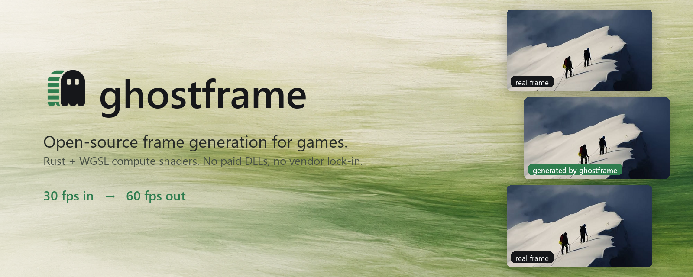
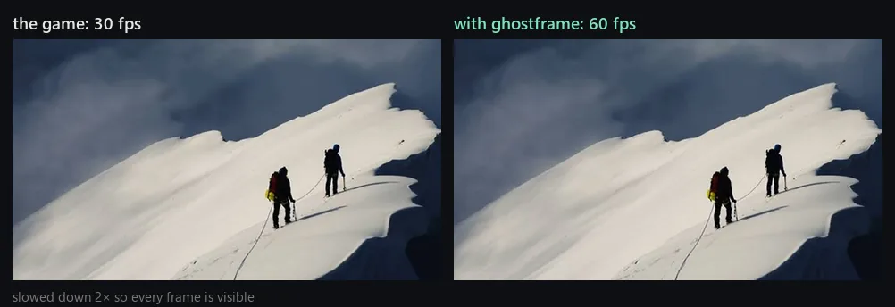

<p align="center"></p>

ghostframe doubles a game's frame rate by creating the frames in between the ones it renders: motion-compensated interpolation on the GPU, written from scratch in Rust and WGSL compute shaders. Free and open source, any GPU with Vulkan, no game integration, no paid DLLs.

**0.78 ms per generated 1080p frame** on an RTX 4060. 30 → 60 fps, 60 → 120 fps.


*A frame the game never rendered. A camera pans across a photo at 60 fps; ghostframe gets every other frame and rebuilds the rest. PSNR against the real frames: repeat 22.9 dB, cross-fade 25.6 dB, **ghostframe 42.6 dB**.*



## Install

```powershell
# Windows
irm https://raw.githubusercontent.com/Lyamon4/ghostframe/main/install.ps1 | iex
```
```bash
# Linux / Steam Deck
curl -fsSL https://raw.githubusercontent.com/Lyamon4/ghostframe/main/install.sh | sh
```

## Use

Start the game the way you always do. Click the ghostframe icon in the notification area: it lists the running games with their frame rate. Tick **Frame generation** and it turns on within a second, no restart. The choice is remembered per game.


| where | how |
|---|---|
| Windows | start the game, click the tray icon, tick **Frame generation** |
| Steam on Linux / Steam Deck | launch options: `ENABLE_GHOSTFRAME=1 %command%` |
| any game, on from the start | `ghostframe run <game executable> [args]` |
| keep it out of a program | `DISABLE_GHOSTFRAME=1` |

`ghostframe status` shows what is installed and which games use it. `ghostframe uninstall` removes everything.

**Games:** every Vulkan game. On Linux and Steam Deck that includes DirectX 9–12 games through Proton (DXVK, VKD3D-Proton). 8-bit swapchains get generated frames; HDR swapchains pass through untouched.

**Best result:** cap the game at half your refresh rate (30 for 60 Hz, 72 for 144 Hz).

## Numbers

Time per generated frame, RTX 4060:

| resolution | time | generated frames/s |
|---|---|---|
| 1280×720 | 0.43 ms | 2335 |
| 1920×1080 | 0.78 ms | 1278 |
| 2560×1440 | 1.25 ms | 797 |
| 3840×2160 | 2.36 ms | 424 |

Quality, `ghostframe bench`: game-like scenes at 60 fps, every other frame dropped and regenerated, compared with the real one (PSNR, 960×540):

| scene | motion | repeat frame | cross-fade | **ghostframe** |
|---|---|---|---|---|
| pan | camera pan, 6 px/frame | 22.1 dB | 25.3 dB | **38.0 dB** |
| sprites | 8 objects up to 14 px/frame, occlusions | 25.1 dB | 27.8 dB | **35.1 dB** |
| fast | camera 22 px/frame + objects 30 px/frame | 16.5 dB | 18.9 dB | **26.4 dB** |
| zoom | zoom in 1.5%/frame | 24.2 dB | 27.4 dB | **38.2 dB** |
| **mean** | | 22.0 dB | 24.8 dB | **34.4 dB** |

Inside a real Vulkan swapchain, through the installed layer (`ghostframe test-game`, frame dumped with `GHOSTFRAME_DUMP`, checked with `ghostframe verify-dump`):

```
ghostframe: 30 real fps -> 60 presented fps (150 generated, 0 skipped, 0.17 ms/frame in the layer on the CPU)

  repeat frame   26.20 dB
  cross-fade     28.89 dB
  ghostframe     35.62 dB   (in-game, through the Vulkan layer)
```

## How it works

ghostframe is a **Vulkan layer**, the mechanism MangoHud and OBS use. It catches every presented frame, generates the in-between one on the game's own GPU queue and presents both. Everything runs in compute shaders ([`src/shaders`](src/shaders)):

1. **Luma pyramid.** Each frame is reduced to brightness at 1/1 down to 1/16 scale.
2. **Bilateral motion search on the in-between grid.** For each 8×8 block of the frame being created, find the motion `v` such that the old frame at `p − v/2` matches the new frame at `p + v/2`. Every output block gets exactly one vector: no holes, no overlaps. Coarse to fine:
   - exhaustive ±6 px search at the coarsest level (±96 px at full resolution);
   - on each finer level, seeds from the coarser level and the 8 neighbouring blocks (3-D recursive search) with a smoothness penalty;
   - refinement to a quarter pixel.

   One 64-thread workgroup per block: the threads split the matching window and test 8 candidate vectors per round. The search stops at a short side of max(180, height / 6) pixels; finer search measures no better.
3. **Vector median filter.** Isolated wrong vectors are replaced by the most central vector of their 3×3 neighbourhood.
4. **Per-pixel composition** at full resolution. Where neighbouring blocks disagree (object edges), each pixel picks the vector whose two motion-compensated samples agree best, then blends the two frames by time `t`. Any `t` works, so 3× and 4× fall out naturally.

The tray app and the layer talk through files in `%LOCALAPPDATA%\ghostframe`: each game writes its frame rates once a second, the tray writes per-game settings the layer re-reads.

## Build from source

```bash
git clone https://github.com/Lyamon4/ghostframe && cd ghostframe
cargo build --release --workspace       # app, tray app, Vulkan layer
target/release/ghostframe install       # register the freshly built layer
cargo run --release -- demo            # live window: a game at 30 fps vs ghostframe at 60 fps
cargo run --release -- bench            # the quality table
cargo run --release -- speed            # GPU time per frame at 1080p
cargo run --release -- interp frames/ out/ --factor 2   # double the frame rate of a PNG sequence
```

Video: `ffmpeg -i clip.mp4 frames/%05d.png`, `interp`, then `ffmpeg -framerate 60 -i out/%06d.png clip60.mp4`.

```
src/
  engine.rs               GPU pipeline: textures, bind groups, dispatch order
  shaders/                pyramid.wgsl, motion.wgsl, compose.wgsl
  scene.rs                procedural test scenes with exact ground truth, PSNR
  demo.rs                 side-by-side live window
  main.rs                 CLI
  install.rs              layer registration, tray autostart
  testgame.rs             a Vulkan test game + dump verification
  bin/ghostframe-tray.rs  notification-area app
layer/
  src/lib.rs              loader interface, dispatch chain, swapchain and present hooks
  src/fg.rs               the engine on raw Vulkan (ash)
  src/session.rs          status files for the tray, per-game settings
  build.rs                WGSL -> SPIR-V with naga
scripts/                  logo and README media, generated from real output
```

## License

MIT. Everything here is original: no code, shaders or binaries from Lossless Scaling or any other proprietary tool.
