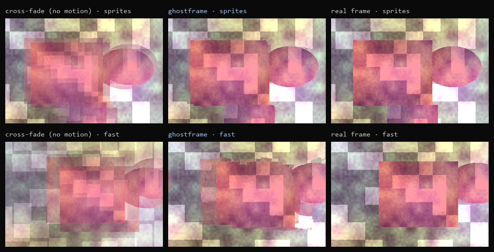
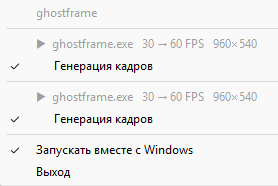

# ghostframe

**Open-source frame generation. No paid DLLs, no vendor lock-in.**

ghostframe creates the frames in between the ones a game renders: motion-compensated interpolation on the GPU, written from scratch in Rust and WGSL compute shaders. It runs on Vulkan, DirectX 12 and Metal through [wgpu](https://wgpu.rs).

The goal: what Lossless Scaling's frame generation does, but free and open. Today the Linux port of that feature ([lsfg-vk](https://github.com/PancakeTAS/lsfg-vk)) still needs the DLL from the paid Windows app, and AMD's open FSR 3 frame generation only works in games that integrate it. ghostframe needs nothing but the frames themselves.



*A dropped frame regenerated from its two neighbours. Left: a plain cross-fade. Middle: ghostframe. Right: the frame the game actually rendered.*

## Play games with it

ghostframe ships as a **Vulkan layer**, the same mechanism MangoHud and OBS use. It sits between the game and the driver, catches every presented frame, generates the in-between one on the game's own GPU queue, and presents both.

**Install** (one command):

```powershell
# Windows
irm https://raw.githubusercontent.com/Lyamon4/ghostframe/main/install.ps1 | iex
```
```bash
# Linux / Steam Deck desktop mode
curl -fsSL https://raw.githubusercontent.com/Lyamon4/ghostframe/main/install.sh | sh
```

**Use it.** On Windows, just start the game the way you always do. No launch options, no commands. Click the ghostframe icon in the notification area: it lists the games running right now with their frame rate, and **Frame generation** switches it on or off for that game within a second, without restarting it. The choice is remembered per game. With no game running it says so.



Until you switch it on, the layer only watches: frames pass through untouched and the generation engine isn't even created. The tray app starts with Windows (untick it in the menu if you don't want that).

| where | how |
|---|---|
| Windows | start the game, click the tray icon, tick **Frame generation** |
| Steam on Linux (Proton or native) | launch options: `ENABLE_GHOSTFRAME=1 %command%` |
| any game, generation on from the start | `ghostframe run <game executable> [args]` |
| keep ghostframe out of a program | `DISABLE_GHOSTFRAME=1` in its environment |

`ghostframe status` shows what is installed and which games use it, `ghostframe tray` starts the tray app, `ghostframe uninstall` removes everything.

**Which games:**

- **Linux and Steam Deck:** practically everything. Native Vulkan games, and DirectX 9–12 games through Proton, because DXVK and VKD3D-Proton turn them into Vulkan before they reach the screen.
- **Windows:** games that render with Vulkan (for example DOOM Eternal, or Red Dead Redemption 2 in Vulkan mode). Plain DirectX games on Windows don't go through Vulkan, so the layer can't see them; that needs window capture (on the roadmap).
- Swapchains in 8-bit BGRA/RGBA formats (what almost every game uses). HDR and 10-bit swapchains are passed through untouched.

**Checked end to end, inside a real Vulkan swapchain.** `ghostframe test-game` is a small Vulkan game that renders the benchmark scene at 30 fps. Run through the installed layer on an RTX 4060:

```
ghostframe: frame generation on: 960x540 B8G8R8A8_UNORM, 4 swapchain images
ghostframe: 30 real fps -> 61 presented fps (152 generated, 0 skipped, 0.19 ms/frame in the layer on the CPU)
ghostframe: dumped generated frame between real frames 198 and 199
```

The layer can dump a generated frame (`GHOSTFRAME_DUMP=file`, `GHOSTFRAME_DUMP_FRAME=n`), and `ghostframe verify-dump` compares it with the frame the game would have rendered:

| that frame, in-game | PSNR |
|---|---|
| repeat (no frame generation) | 26.2 dB |
| cross-fade | 28.9 dB |
| **ghostframe, through the layer** | **35.6 dB** |

**Online games:** Vulkan layers are an ordinary, documented mechanism (Steam's overlay, OBS and MangoHud use it), and the Vulkan loader puts ghostframe into every Vulkan game, like theirs. But anti-cheat systems make their own rules and frame generation adds latency. Use ghostframe in single-player games; for a competitive online game, keep it out with `DISABLE_GHOSTFRAME=1` or uninstall it while you play.

**Pacing:** generated frames are presented right before the real one, so with vsync the display alternates real and generated frames. As with every frame-generation tool, the smoothest result comes from capping the game at half your refresh rate (30 for 60 Hz, 72 for 144 Hz). It adds about one frame of latency.

Environment variables: `GHOSTFRAME_LOG=file` writes the layer's log to a file (handy for games without a console), `GHOSTFRAME_MODE=off` disables generation while keeping the layer loaded.

## Measured, not eyeballed

`ghostframe bench` renders game-like scenes, drops every other frame of a 60 fps sequence, regenerates it, and compares it with the real one (PSNR, higher is better):

| scene | motion | repeat frame | cross-fade | **ghostframe** |
|---|---|---|---|---|
| pan | camera pan, 6 px/frame | 22.1 dB | 25.3 dB | **38.0 dB** |
| sprites | 8 objects up to 14 px/frame, occlusions | 25.1 dB | 27.8 dB | **35.1 dB** |
| fast | camera 22 px/frame + objects 30 px/frame | 16.5 dB | 18.9 dB | **26.4 dB** |
| zoom | zoom in 1.5%/frame | 24.2 dB | 27.4 dB | **38.2 dB** |
| **mean** | | 22.0 dB | 24.8 dB | **34.4 dB** |

*960×540, RTX 4060 (Vulkan). "Repeat frame" is what you see without frame generation; "cross-fade" is interpolation without motion.*

Speed on an RTX 4060, per generated frame:

| resolution | time | generated frames/s |
|---|---|---|
| 1280×720 | 4.4 ms | 229 |
| 1920×1080 | 6.5 ms | 153 |
| 2560×1440 | 12.5 ms | 80 |

Comfortably fast enough to take a 1080p game from 30 to 60 fps or from 60 to 120 fps.

## Try it

```bash
git clone https://github.com/Lyamon4/ghostframe && cd ghostframe
cargo build --release --workspace       # app + Vulkan layer
target/release/ghostframe install       # register the freshly built layer (re-run after rebuilding)
cargo run --release -- demo            # live window: a game at 30 fps vs ghostframe at 60 fps
cargo run --release -- bench --save out # the quality table above, plus example frames
cargo run --release -- speed            # GPU time per frame at 1080p
cargo run --release -- interp frames/ out/ --factor 2   # double the frame rate of a PNG sequence
```

To use your own footage: `ffmpeg -i clip.mp4 frames/%05d.png`, run `interp`, then `ffmpeg -framerate 60 -i out/%06d.png clip60.mp4`.

## How it works

Everything runs in compute shaders ([`src/shaders`](src/shaders)):

1. **Luma pyramid.** Each frame is reduced to brightness at 1/1, 1/2, 1/4, 1/8 and 1/16 scale.
2. **Bilateral motion search on the in-between grid.** For each 8×8 block of the frame being created, find the motion `v` such that the old frame at `p − v/2` matches the new frame at `p + v/2`. Searching on the output grid gives every output block exactly one vector: no holes and no overlaps, unlike pushing a flow field forward. It goes coarse to fine:
   - an exhaustive ±6 px search at 1/16 scale (±96 px at full resolution), so fast motion is caught;
   - at each finer level, seeds from the coarser level plus candidates from the 8 neighbouring blocks (3-D recursive search, the technique behind TV motion smoothing), with a smoothness penalty;
   - refinement down to a quarter pixel.

   From 360p up, the search stops at half resolution. It is 4× cheaper and measured no worse.
3. **Vector median filter.** Isolated wrong vectors are replaced by the most central vector of their 3×3 neighbourhood.
4. **Per-pixel composition.** Each output pixel uses a smooth (bilinear) vector field. Where neighbouring blocks disagree, at object edges, it picks the vector whose two motion-compensated samples agree best on a small luma cross, then blends the two frames by time `t`. Any `t` works, so 3× and 4× frame generation fall out naturally.

On GPUs that can filter 32-bit float textures (all desktop GPUs), block matching uses hardware bilinear sampling. Elsewhere a manual path is compiled in.

```
src/
  engine.rs   GPU pipeline: textures, bind groups, dispatch order
  shaders/    pyramid.wgsl, motion.wgsl, compose.wgsl
  scene.rs    procedural game-like test scenes with exact ground truth, PSNR
  demo.rs     side-by-side live window (winit + wgpu)
  main.rs     CLI: bench, speed, interp, demo, install, run, tray, status, test-game, verify-dump
  install.rs  layer registration (Windows registry / Linux implicit_layer.d), tray autostart
  bin/ghostframe-tray.rs  notification-area app: running games, per-game switch
  testgame.rs a Vulkan test game + dump verification
layer/
  src/lib.rs  Vulkan layer: loader interface, dispatch chain, swapchain and present hooks
  src/fg.rs   the engine on raw Vulkan (ash): images, descriptors, pipelines, per-present commands
  src/session.rs  status files for the tray (sessions/<pid>.json) and per-game settings (games.cfg)
  build.rs    compiles src/shaders/*.wgsl to SPIR-V with naga
```

## Status and roadmap

ghostframe is a working interpolation engine with an honest benchmark and a Vulkan layer that runs it inside games.

- [x] GPU motion estimation and frame composition, any `t`
- [x] Ground-truth benchmark, speed test, PNG-sequence interpolation, live demo
- [x] **Vulkan layer** for games (`ENABLE_GHOSTFRAME=1 %command%`): hooks `vkQueuePresentKHR`, runs the same shaders (WGSL compiled to SPIR-V by naga at build time) on the game's device and queue, presents the extra frames. Tested end to end on Windows (RTX 4060); Linux is built and tested in CI on a software GPU.
- [x] One-command install (`install.ps1`, `install.sh`, `ghostframe install`) and release builds.
- [x] Tray app on Windows: games appear by themselves, frame generation switched per game with one click.
- [ ] Testing on real Proton games and on a Steam Deck.
- [ ] Frame pacing: spacing the generated present to the middle of the frame interval instead of right before the real one.
- [ ] 3× / 4× generation in the layer (the engine already supports any `t`).
- [ ] **Windows window capture**, Lossless Scaling style: capture a game window and present at 2× in a borderless overlay.
- [ ] **Better occlusions.** The weak spot is visible in the "fast" row: where an object uncovers background, both frames don't contain the same pixels. Using a third frame to decide which side is visible is the next step.
- [ ] Optional small learned refinement pass for edges.

## License

MIT. Everything here is original. No code, shaders or binaries from Lossless Scaling or any other proprietary tool.
